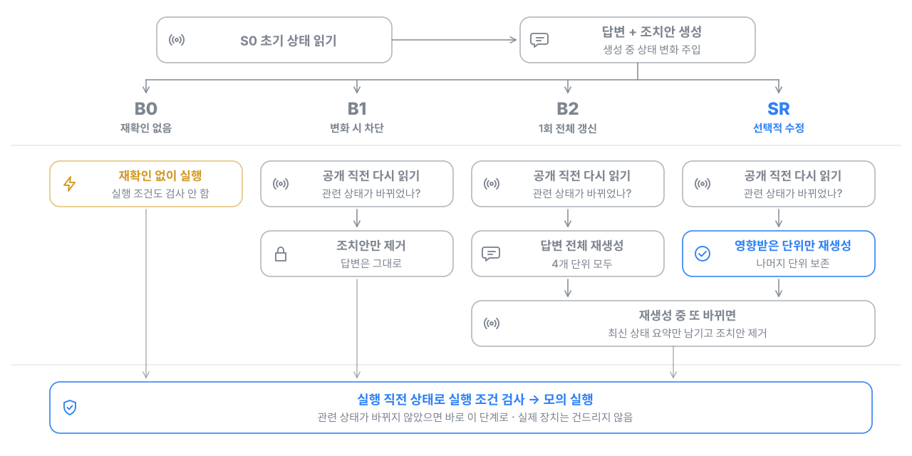
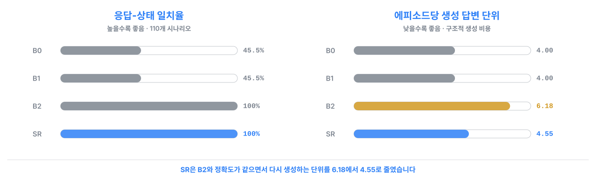

# Smartfarm State Revalidation — 센서 변화 기반 선택적 답변 수정


[](https://github.com/NAMUORI00/smartfarm-state-revalidation/actions/workflows/ci.yml)

> **English summary.** Research module from my master's thesis on smart-farm AI operations support. When sensor state changes after an AI answer is generated but before it is released or acted on,
> this harness re-reads the state and rewrites only the answer units whose declared state-key dependencies changed (SR), instead of blocking (B1) or regenerating everything (B2).
> Evaluated with a deterministic generator on 120 simulated, pre-registered scenarios: SR matched B2 on every correctness metric while generating fewer answer units per episode.

## 한눈에 보기

- **문제**: AI가 센서 값을 읽고 답변과 조치안(예: 냉각기 켜기)을 만드는 사이에 센서 값이 바뀌면, 답변 속 수치와 조치안이 이미 지나간 상태를 기준으로 남습니다. 막기만 하면 쓸모 있는 조치까지 사라지고, 답변 전체를 다시 만들면 바뀌지 않은 문장까지 다시 생성합니다.
- **내가 한 일**: 생성 직후와 실행 직전에 상태를 다시 확인하는 실행 엔진, 비교 조건 4종(B0, B1, B2, SR), 사전 선언한 의존관계로 영향받은 단위만 고치는 SR, 판정자 없는 자동 평가, 프로토콜 동결부터 확정 실행까지의 절차를 혼자 설계하고 구현했습니다.
- **결과**: 동결된 확정 시나리오 120개에서 SR은 B2와 응답 일치율, 유효 행동 유지, 무효 행동 차단이 모두 같았고(짝 차이 0, 95% 구간 [0, 0]), 에피소드당 생성 답변 단위는 **6.18 → 4.55**로 줄었습니다. 의존성 없이 10초 만에 같은 결과를 재현할 수 있습니다.

## 쉽게 설명하면

운영자가 "1구역 근권 온도 경보를 확인하고 필요한 냉각 조정을 제안해줘"라고 물었다고 하겠습니다. AI 답변은 미리 정해 둔 4개 단위로 나뉩니다.

| 답변 단위 | 의존하는 상태 키 | 처음 만든 문장 |
|---|---|---|
| `sensor_reading` | 근권 온도 | 근권 온도 18.81°C |
| `alert_status` | 근권 고온 경보 on/off, 경보 ID | 고온 경보 켜짐 |
| `device_status` | 근권 냉각기 on/off | 냉각기 꺼짐 |
| `data_quality` | 데이터 수신 여부, 측정 후 경과 시간 | 수신 정상, 10초 전 측정 |

조치안은 "냉각기 켜기 (실행 조건: 근권 온도 > 18°C, 경보 켜짐, 냉각기 꺼짐)"입니다. 그런데 답변을 만드는 도중 근권 온도가 **17.81°C**로 내려갔습니다.

| 조건 | 하는 일 | 공개되는 답변 | 냉각기 켜기 |
|---|---|---|---|
| **B0** 재확인 없음 | 처음 답변을 그대로 내보내고 바로 실행 | 18.81°C (틀림) | 실행됨 (이미 필요 없는 조치) |
| **B1** 변화 시 차단 | 바뀐 걸 알아채고 조치안만 버림 | 18.81°C (틀림) | 막힘 |
| **B2** 1회 전체 갱신 | 4개 단위를 모두 다시 생성 | 17.81°C (맞음) | 조건 불충족 → 조치안 없음 |
| **SR** 선택적 수정 | 근권 온도에 의존하는 `sensor_reading`만 다시 생성, 나머지 3개는 보존 | 17.81°C (맞음) | 조건 불충족 → 조치안 없음 |

어떤 단위를 고칠지는 **생성된 문장을 보고 정하지 않습니다**. 미리 선언한 의존관계와 상태 차이만 보고 정하므로, 같은 입력이면 항상 같은 단위가 수정됩니다.

## 비교 조건 흐름



## 결과



확정 시나리오 120개(12개 범주 × 변형 10개, 주 평가 110개와 진단 10개)의 결과입니다. 출처는 [`confirmatory-v2.json`](results/confirmatory-v2.json)입니다.

| 지표 | B0 | B1 | B2 | SR |
|---|---|---|---|---|
| 응답-상태 일치율 (↑) | 50/110 (45.5%) | 50/110 (45.5%) | 110/110 (100%) | 110/110 (100%) |
| 무효 행동 모의 실행률 (↓) | 80/80 (100%) | 0/80 (0%) | 0/80 (0%) | 0/80 (0%) |
| 유효 행동 유지율 (↑) | 30/50 (60%) | 30/50 (60%) | 50/50 (100%) | 50/50 (100%) |
| 에피소드당 생성 답변 단위 (↓) | 4.00 | 4.00 | 6.18 | **4.55** |
| 수정 정밀도 (고친 단위 중 실제 영향 단위) | – | – | 60/240 (25%) | **60/60 (100%)** |

| 짝 비교 | 차이 | 95% 구간 (짝 bootstrap 10,000회) |
|---|---|---|
| SR − B2 응답-상태 일치율 | 0 | [0, 0] |
| SR − B2 생성 답변 단위 | −1.64 | [−1.91, −1.36] |
| SR − B0 응답-상태 일치율 | +0.545 | [0.455, 0.636], exact McNemar p ≈ 1.7×10⁻¹⁸ |

생성 답변 단위는 결정론적 하네스 안에서 센 구조적 생성 비용입니다. 센서 결측과 조회 실패를 다루는 보완 검증 결과는 [docs/details.md](docs/details.md)에 있습니다.

## 검증 절차

입력 계약 확인과 결정론 검사를 거친 뒤 pilot으로 분모와 계약만 확인하고, 시나리오와 의존관계, 생성기를 SHA-256으로 동결한 다음 확정 실행을 한 번 수행했습니다. 확정 실행은 동결 해시가 일치할 때만 시작되고, 산출물 해시와 통계를 다시 집계해 검증합니다.

## 담당 범위

설계, 구현, 실험, 분석을 단독으로 진행했습니다.

| 영역 | 설계하고 구현한 내용 | 관련 파일 |
|---|---|---|
| 실행 엔진 | 상태 읽기 지점(초기, 공개 직전, 실행 직전), 12개 barrier 순서 기록, 갱신 1회 제한 | [`engine.py`](src/smartfarm_state_revalidation/engine.py) |
| 비교 조건 | B0, B1, B2, SR을 4개 스위치 조합으로 정의 | [`policies.py`](src/smartfarm_state_revalidation/policies.py) |
| 선택적 수정 (SR) | 답변 단위와 상태 키 의존관계 선언, 상태 지문(SHA-256)과 허용 오차 비교, 영향 단위 계산 | [`dependency.py`](src/smartfarm_state_revalidation/dependency.py), [`fingerprint.py`](src/smartfarm_state_revalidation/fingerprint.py) |
| 모의 실행 | 조치안의 실행 조건을 실행 직전 상태로 검사, 실제 장치는 건드리지 않음 | [`executor.py`](src/smartfarm_state_revalidation/executor.py) |
| 자동 평가 | 판정자 없는 oracle, 지표 9종, Wilson 구간, 짝 bootstrap, exact McNemar, 산출물 해시 검증 | [`evaluation/`](src/smartfarm_state_revalidation/evaluation) |
| 프로토콜과 시나리오 | 프로토콜 v1, v2, 12개 범주 × 10 변형 시나리오 생성기, 입력 해시 동결 | [`protocols/`](protocols), [`scenario_generation.py`](src/smartfarm_state_revalidation/scenario_generation.py) |
| 테스트 | 단위, 프로토콜, 결과 색인 테스트 116개와 CI | [`tests/`](tests) |

개발 도구로 Claude Code와 Codex(AI 코딩 에이전트)를 사용했습니다.

## 실행 방법

외부 패키지 없이 Python 표준 라이브러리만 씁니다(테스트에만 pytest).

```bash
git clone https://github.com/NAMUORI00/smartfarm-state-revalidation.git
cd smartfarm-state-revalidation
python -m pip install -e ".[test]"
python -m pytest
```

확정 실행 재현 (약 10초):

```bash
python -m smartfarm_state_revalidation run \
  --protocol protocols/protocol.v2.json \
  --scenarios protocols/scenarios.confirmatory.v1.json \
  --related-state protocols/related-state.v2.json \
  --output output/dev-run \
  --repository-commit 0000000000000000000000000000000000000000 \
  --claim-status not_claimed
python -m smartfarm_state_revalidation verify-artifacts --output output/dev-run
```

## 디렉터리 구조

```text
smartfarm-state-revalidation/
├── src/smartfarm_state_revalidation/
│   ├── engine.py, policies.py, contracts.py        # 실행 엔진과 비교 조건 정의
│   ├── dependency.py, fingerprint.py, generator.py # 의존관계, 상태 지문, 결정론적 생성기
│   ├── executor.py                                 # 실행 조건 검사와 모의 실행
│   └── evaluation/                                 # oracle, 지표, 통계, 산출물 검증
├── protocols/       # 동결된 프로토콜, 의존관계, 시나리오
├── results/         # 확정 실행 결과 색인
└── tests/
```

## 한계와 다음 단계

- 수치는 결정론적 생성기, 시뮬레이션 상태, 모의 실행기에서 나온 메커니즘 검증입니다.
- 다음 단계로 실제 LLM 생성기를 연결해 자연어 답변 품질과 토큰, 지연 비용을 측정하고, 여러 단위가 동시에 바뀌는 시나리오로 확장합니다.

## 학위논문 연계

제주대학교 대학원 컴퓨터공학과 석사학위논문(2027년 2월 예정)의 「센서 변화 기반 선택적 답변 수정」 장을 구현하고 실험한 저장소입니다. 같은 논문의 검색 채널 제어와 운영 시스템은 [smartfarm-adaptive-rag](https://github.com/NAMUORI00/smartfarm-adaptive-rag)에 있습니다.

라이선스는 따로 정하지 않았습니다(열람 목적 공개). 문의: [@NAMUORI00](https://github.com/NAMUORI00)
