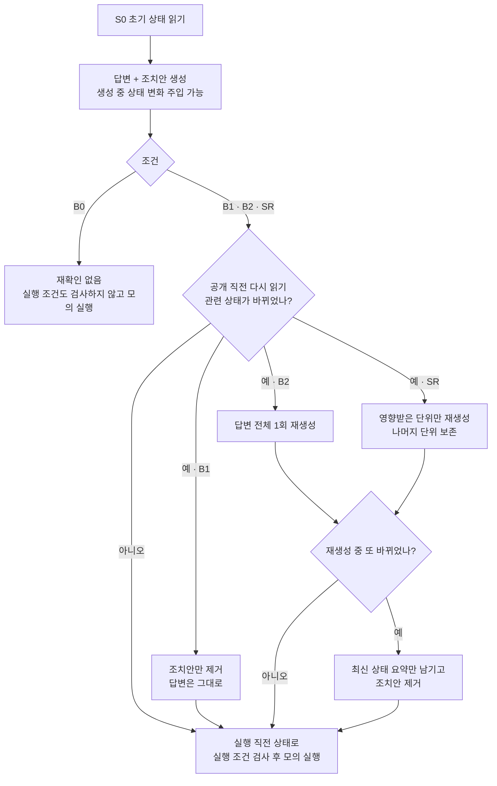
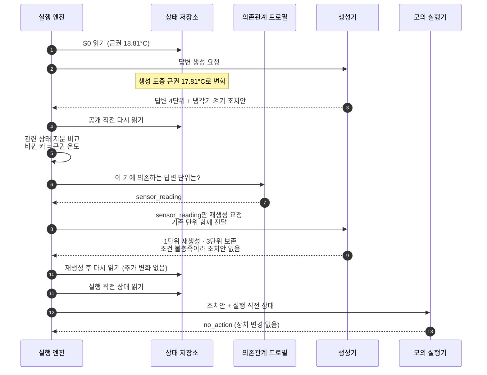
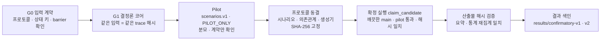

# Smartfarm State Revalidation — 센서 변화 기반 선택적 답변 수정


> **English summary.** Research module from my master's thesis on smart-farm AI operations support. When sensor state changes after an AI answer is generated but before it is released or acted on,
> this harness re-reads the state and rewrites only the answer units whose declared state-key dependencies changed (SR), instead of blocking (B1) or regenerating everything (B2).
> Evaluated with a deterministic generator on 120 simulated, pre-registered scenarios: SR matched B2 on every correctness metric while generating fewer answer units per episode.

---

## 한눈에 보기

- **문제**: AI가 센서 값을 읽고 답변과 조치안(예: 냉각기 켜기)을 만드는 사이에 센서 값이 바뀌면, 답변 속 수치와 조치안이 이미 지나간 상태를 기준으로 남습니다. 막기만 하면 쓸모 있는 조치까지 사라지고, 답변 전체를 다시 만들면 바뀌지 않은 문장까지 다시 생성합니다.
- **내가 한 일**: 생성 직후와 실행 직전에 상태를 다시 확인하는 실행 엔진, 비교 조건 4종(B0/B1/B2/SR), 사전 선언한 "답변 단위 ↔ 상태 키" 의존관계로 영향받은 단위만 고치는 SR, 판정자 없는 자동 oracle·통계, 프로토콜 동결 → pilot → 확정 실행 절차를 혼자 설계·구현했습니다.
- **결과**: 동결된 확정 시나리오 120개(주 평가 110 + 진단 10)에서 SR은 B2와 응답 일치율·유효 행동 유지·무효 행동 차단이 모두 같았고(짝 차이 0, 95% 구간 [0, 0]), 에피소드당 생성 답변 단위는 6.18 → 4.55로 줄었습니다(짝 차이 −1.64, 95% 구간 [−1.91, −1.36]). 공개본에서 다시 실행해도 기록된 산출물 해시가 그대로 나옵니다.

## 쉽게 설명하면

운영자가 "1구역 근권 온도 경보를 확인하고 필요한 냉각 조정을 제안해줘"라고 물었다고 하겠습니다. AI 답변은 미리 정해 둔 4개 단위로 나뉩니다.

| 답변 단위 | 의존하는 상태 키 | 처음 만든 문장 |
|---|---|---|
| `sensor_reading` | 근권 온도 | 근권 온도 18.81°C |
| `alert_status` | 근권 고온 경보 on/off, 경보 ID | 고온 경보 켜짐 |
| `device_status` | 근권 냉각기 on/off | 냉각기 꺼짐 |
| `data_quality` | 데이터 수신 여부, 측정 후 경과 시간 | 수신 정상, 10초 전 측정 |

조치안은 "냉각기 켜기 (실행 조건: 근권 온도 > 18°C, 경보 켜짐, 냉각기 꺼짐)"입니다. 그런데 답변을 만드는 도중 근권 온도가 **17.81°C**로 내려갔습니다.

| 조건 | 하는 일 | 공개되는 답변 | 냉각기 켜기 |
|---|---|---|---|
| **B0** 재확인 없음 | 처음 답변을 그대로 내보내고 바로 실행 | 18.81°C (틀림) | 실행됨 (이미 필요 없는 조치) |
| **B1** 변화 시 차단 | 바뀐 걸 알아채고 조치안만 버림 | 18.81°C (틀림) | 막힘 |
| **B2** 1회 전체 갱신 | 4개 단위를 모두 다시 생성 | 17.81°C (맞음) | 조건 불충족 → 조치안 없음 |
| **SR** 선택적 수정 | 근권 온도에 의존하는 `sensor_reading`만 다시 생성, 나머지 3개는 보존 | 17.81°C (맞음) | 조건 불충족 → 조치안 없음 |

어떤 단위를 고칠지는 **생성된 문장을 보고 정하지 않습니다**. 시나리오가 시작되기 전에 선언해 둔 의존관계와 상태 차이만 보고 정하므로, 같은 입력이면 항상 같은 단위가 수정됩니다.

## 나의 기여

**김유석 ([@NAMUORI00](https://github.com/NAMUORI00))** — 설계, 구현, 실험, 분석을 단독으로 진행했습니다. 비공개 원본 저장소의 이 모듈 경로 기준 2026-08-07 ~ 2026-10-07 커밋 16개를 모두 본인 계정으로 작성했습니다.

| 영역 | 직접 설계·구현한 내용 | 관련 파일 |
|---|---|---|
| 실행 엔진 | 상태 읽기 지점 S0 → 공개 직전 → 실행 직전, 12개 barrier 순서 기록, 갱신 1회 제한, 갱신 중 또 바뀌면 최신 상태 요약만 남기고 조치안 제거 | [`engine.py`](src/smartfarm_state_revalidation/engine.py), [`trace.py`](src/smartfarm_state_revalidation/trace.py) |
| 비교 조건 | B0/B1/B2/SR을 "갱신 횟수 · 변화 시 차단 · 실행 조건 검사 · 선택적 수정" 4개 스위치 조합으로 정의 | [`policies.py`](src/smartfarm_state_revalidation/policies.py), [`contracts.py`](src/smartfarm_state_revalidation/contracts.py) |
| 선택적 수정 (SR) | 답변 단위·상태 키 의존관계 선언, 관련 상태 지문(SHA-256)과 허용 오차·경계값 비교, 영향받은 단위 계산, 보존 단위는 원래 관측 revision 유지 | [`dependency.py`](src/smartfarm_state_revalidation/dependency.py), [`fingerprint.py`](src/smartfarm_state_revalidation/fingerprint.py), [`generator.py`](src/smartfarm_state_revalidation/generator.py) |
| 모의 실행 | 조치안의 실행 조건(gt/eq 등)을 실행 직전 상태로 검사, 실제 장치는 건드리지 않음 | [`executor.py`](src/smartfarm_state_revalidation/executor.py) |
| 자동 평가 | 사람·LLM 판정자 없는 oracle, 지표 9종, Wilson 구간, 짝 bootstrap, exact McNemar, 산출물 해시 묶음과 재집계 검증 | [`evaluation/`](src/smartfarm_state_revalidation/evaluation) |
| 프로토콜·시나리오 | v1(B0/B1/B2)·v2(+SR) 프로토콜, 12개 범주 × 10 변형 확정 시나리오 생성기, 입력 해시 동결, claim 실행 조건 검사 | [`protocols/`](protocols), [`scenario_generation.py`](src/smartfarm_state_revalidation/scenario_generation.py), [`cli.py`](src/smartfarm_state_revalidation/cli.py) |
| 보완 검증 | 센서 값 결측·필드 조회 오류·전체 조회 오류·회복 상황의 필드 단위 가용성 처리와 두 장치 동시 판정 | [`availability.py`](src/smartfarm_state_revalidation/availability.py), [`availability_followup.py`](src/smartfarm_state_revalidation/evaluation/availability_followup.py), [`availability_joint.py`](src/smartfarm_state_revalidation/evaluation/availability_joint.py) |
| 격리·테스트 | 제품 Compose 프로젝트·포트 사용 거부, 단위·프로토콜·결과 색인 테스트 116개 | [`isolation.py`](src/smartfarm_state_revalidation/isolation.py), [`tests/`](tests), [`ci.yml`](.github/workflows/ci.yml) |

**AI 코딩 도구 사용**: Codex와 Claude Code를 페어 프로그래밍 도구로 썼고, 실험 설계·판정 기준·결과 해석은 직접 정하고 테스트로 확인했습니다.

---

## 비교 조건 흐름 (B0 / B1 / B2 / SR)



## SR 처리 순서



## 검증 절차



- v1(B0/B1/B2)과 v2(+SR)는 각각 pilot → 동결 → 확정 실행을 따로 거쳤습니다. v2는 v1과 **같은 확정 시나리오**를 그대로 써서 SR만 추가된 효과를 볼 수 있게 했습니다.
- `claim_candidate` 실행은 [`cli.py`](src/smartfarm_state_revalidation/cli.py)에서 깨끗한 `main`, 통과한 pilot, 동결 해시 일치, 시나리오당 1회 실행 조건을 모두 만족해야만 시작됩니다.
- 결과 파일에는 동결 뒤 비확정 임시 실행이 한 번 있었다는 사실과 그 이후 바꾼 범위(해시 직렬화, 지표 이름 정렬)를 함께 적어 두었습니다(`preclaim_audit_disclosure`).

## 결과

확정 시나리오 120개: 12개 범주(변화 없음, 무관한 변화, 허용 오차 내 잡음, 기준값 통과, 경보 해제, 새 경보, 장치 사전 변경, 상충 경보, 갱신 중 2차 변화, 오래된 상태, 실행 검사 직전 변화, 적용 시점 변화) × 변형 10개. 출처는 [`confirmatory-v2.json`](results/confirmatory-v2.json)이며 B0/B1/B2 수치는 [`confirmatory-v1.json`](results/confirmatory-v1.json)과 같습니다.

| 지표 | B0 | B1 | B2 | SR |
|---|---|---|---|---|
| 응답-상태 일치율 (↑) | 50/110 (45.5%) | 50/110 (45.5%) | 110/110 (100%) | 110/110 (100%) |
| 무효 행동 모의 실행률 (↓) | 80/80 (100%) | 0/80 (0%) | 0/80 (0%) | 0/80 (0%) |
| 유효 행동 유지율 (↑) | 30/50 (60%) | 30/50 (60%) | 50/50 (100%) | 50/50 (100%) |
| 불필요 갱신률 (↓) | 0/50 | 0/50 | 0/50 | 0/50 |
| 에피소드당 생성 답변 단위 (↓) | 4.00 | 4.00 | 6.18 | **4.55** |
| 보존 단위 비율 | – | – | 0/240 (0%) | 180/240 (75%) |
| 수정 정밀도 (고친 단위 중 실제 영향 단위) | – | – | 60/240 (25%) | 60/60 (100%) |
| 수정 재현율 | – | – | 60/60 (100%) | 60/60 (100%) |

| 짝 비교 | 차이 | 95% 구간 (짝 bootstrap 10,000회) |
|---|---|---|
| SR − B2 응답-상태 일치율 | 0 | [0, 0] |
| SR − B2 생성 답변 단위 | −1.64 | [−1.91, −1.36] |
| SR − B0 응답-상태 일치율 | +0.545 | [0.455, 0.636], exact McNemar p ≈ 1.7×10⁻¹⁸ |
| SR − B0 무효 행동 실행 | −1.00 | [−1.00, −1.00] |

- 갱신 중 두 번째 변화가 생긴 진단 시나리오(B2·SR 각 10건)는 20/20 모두 생성 호출 2회 이내에서 조치안을 제거하고 끝났습니다.
- `unit_generation_count`는 결정론적 하네스 안에서 센 **구조적 생성 비용**입니다. LLM 토큰 비용이 아닙니다.
- 공개본 재실행: 아래 명령으로 v2 확정 실행을 다시 돌리면 `episodes.jsonl`, `trace.jsonl`, `summary.json`, `statistics.json`의 SHA-256이 [`confirmatory-v2.json`](results/confirmatory-v2.json)의 `integrity` 값과 같게 나옵니다(2026-10-09, Windows · Python 3.13 확인). v1 색인은 SR 추가 전 코드로 만든 것이라 현재 코드의 기록 형식과 바이트 단위로는 다릅니다.

### 보완 검증: 센서 결측·조회 실패

SR 코어가 "값이 없을 때"와 "읽다가 실패할 때"를 어떻게 다루는지 따로 점검했습니다. 사전 선언한 명명 사례 기반 점검이며 모집단 추론이 아닙니다.

| 단계 | 내용 | 결과 |
|---|---|---|
| 탐색 진단 ([`summary.json`](results/availability-followup-20261004/summary.json)) | 기존 코어에 온도 값 없음 · 온도 조회 오류 · 전체 조회 오류를 각 10건 주입 | 정상 10/10 통과. 값 없음은 팬 판정만 통과(10/10)하고 답변·냉각 판정은 0/10, 조회 오류는 예외로 끝나 0/10 → 처리 공백 확인 |
| 후속 점검 ([`summary.json`](results/availability-joint-20261004-v1/summary.json)) | 필드 단위 가용성 처리(`guarded`)와 기준 처리(`legacy`)를 같은 24개 사례(온도·신선도 경계, 결측, 필드·전체 조회 오류, 회복, 실행 오류, 권한, 격리)로 비교 | `guarded` 답변·냉각·팬·종합 24/24, `legacy` 종합 11/24. 짝 비교 fail→pass 13건, pass→fail 0건 |

## 검증 범위와 남은 일

이 저장소의 수치는 **결정론적 생성기 + 시뮬레이션 상태 + 모의 실행기**에서 나온 메커니즘 검증입니다. 아래 항목은 실행하지 않았고(`not_run`) 주장하지 않습니다.

- [ ] 실제 LLM·RAG 생성기 연결 후 자연어 답변 품질 평가 (현재 `SnapshotEchoGenerator`)
- [ ] 응답 지연, LLM 호출 수·토큰·비용 측정 (현재는 구조적 생성 단위 수만 측정)
- [ ] 실제 농장·물리 장치에서의 안전성·생산성 (현재 `DryRunExecutor`, 장치 호출 금지)
- [ ] 외부 블라인드 held-out 평가 (확정 시나리오는 직접 설계한 템플릿의 변형)
- [ ] 여러 단위가 동시에 바뀌는 SR 표적 시나리오 묶음 (v2 프로토콜에서 후속으로 미룸)
- [ ] 답변 단위·의존관계 자동 도출 (현재는 사전 선언)
- [ ] 격리된 텔레메트리·FarmOps MCP와의 Compose 통합 점검 공개 (공개본 미포함)

## 학위논문 연계

| 항목 | 내용 |
|---|---|
| 논문 | 「근거 기반 선택적 제어를 적용한 스마트팜 RAG 운영 지원 시스템」 |
| 구분 | 제주대학교 대학원 컴퓨터공학과 석사학위논문 — **2027.02 졸업 예정, 작성 중** |
| 이 저장소의 역할 | Ⅵ장 「센서 변화 기반 선택적 답변 수정」의 구현과 실험. 6.1~6.3의 B0/B1/B2/SR 비교, 6.4의 센서 결측·조회 실패 보완 검증 |
| 다른 장과의 관계 | Ⅳ장 질의 적응형 검색 채널 제어(QACT)의 운영 코드는 [smartfarm-adaptive-rag](https://github.com/NAMUORI00/smartfarm-adaptive-rag)에 있습니다. |

논문 원고와 표 생성 도구는 이 저장소에 포함하지 않았습니다.

## 실행 방법

외부 패키지 없이 Python 표준 라이브러리만 씁니다(테스트에만 pytest).

```bash
git clone https://github.com/NAMUORI00/smartfarm-state-revalidation.git
cd smartfarm-state-revalidation
python -m pip install -e ".[test]"
python -m pytest
```

v2 확정 실행 재현 (비확정 상태로 실행, 약 10초):

```bash
python -m smartfarm_state_revalidation run \
  --protocol protocols/protocol.v2.json \
  --scenarios protocols/scenarios.confirmatory.v1.json \
  --related-state protocols/related-state.v2.json \
  --output output/dev-run \
  --repository-commit 0000000000000000000000000000000000000000 \
  --claim-status not_claimed
python -m smartfarm_state_revalidation verify-artifacts --output output/dev-run
```

## 테스트

| 묶음 | 주요 검증 내용 |
|---|---|
| `tests/core` | barrier 순서, 조건별 정책, 관련 상태 지문·허용 오차, 영향 단위 계산, SR의 단위 보존 |
| `tests/evaluation` | oracle 판정, 지표·통계, 산출물 해시 묶음·재집계, 결과 색인과 동결 입력 해시 일치, 가용성 점검 |
| `tests/experiment` | 시나리오 실행 재현성(벽시계 시간 제외) |
| `tests/protocol` | 프로토콜 v1/v2 구조, 확정 시나리오 봉인·해시, 시나리오 생성기 |
| `tests/integration` | 제품 Compose 프로젝트·포트 사용 거부 |

- 2026-10-09 로컬(Windows, Python 3.13)에서 116개 모두 통과했습니다. CI는 Python 3.12에서 실행합니다.

## 디렉터리 구조

```text
smartfarm-state-revalidation/
├── src/smartfarm_state_revalidation/
│   ├── engine.py · policies.py · contracts.py      # 실행 엔진과 B0/B1/B2/SR 정의
│   ├── dependency.py · fingerprint.py · generator.py  # 의존관계, 상태 지문, 결정론적 생성기
│   ├── executor.py                                  # 실행 조건 검사 · 모의 실행
│   ├── experiment.py · scenario_generation.py · cli.py
│   ├── availability.py                              # 필드 단위 가용성 처리 (보완 검증)
│   ├── isolation.py · integration.py · adapters/    # 제품 환경 격리, 통합 점검용 HTTP 어댑터
│   └── evaluation/                                  # oracle · 지표 · 통계 · 산출물 · 가용성 점검
├── protocols/       # 동결된 프로토콜 v1/v2, 의존관계, pilot·확정 시나리오
├── results/         # 확정 실행 결과 색인 v1/v2, 가용성 점검 요약
├── tests/
└── .github/workflows/ci.yml
```

## 공개 범위 안내

- 비공개 연구 저장소의 학위논문 연구 모듈에서 **직접 작성한 코드와 요약 결과만 골라 정리한 공개용 쇼케이스**입니다. 커밋 이력은 원본 개발 이력이 아닙니다.
- 제외한 것: 논문 원고와 표 생성 도구, 실행 원시 기록(사례별 JSON, 소스 스냅샷 zip, HTML 보고서, 미리보기 이미지, 실행 환경 기록), 원고 초안 문장이 들어 있는 자가 검토 모듈, 제품 서비스가 필요한 Compose 통합 점검 파일. 텔레메트리 시뮬레이터와 FarmOps MCP 서비스는 [smartfarm-adaptive-rag](https://github.com/NAMUORI00/smartfarm-adaptive-rag)에서 볼 수 있습니다.
- 확정 실험 입력(프로토콜 v1/v2, 의존관계, 시나리오, 시나리오 생성기)은 원본 그대로이며 동결 해시가 테스트로 확인됩니다. 가용성 점검 프로토콜 2개는 비공개 설계 문서 식별자를 가렸기 때문에 원본 실행 기록의 파일 해시와 다릅니다.
- 모든 상태 값은 실험용으로 만든 입력이며 실제 농장 측정값이 아닙니다.
- 라이선스: 별도 라이선스 없음 (열람 목적 공개)

- 문의: GitHub [@NAMUORI00](https://github.com/NAMUORI00)
