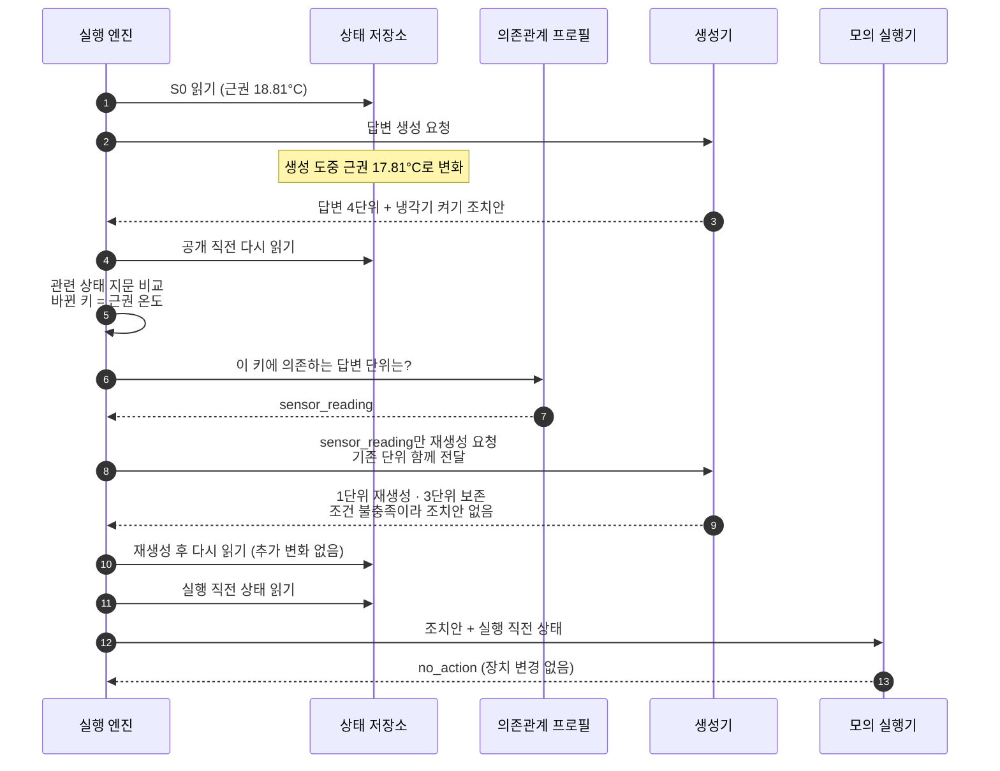
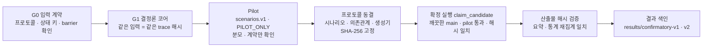

# 상세 기록

[README로 돌아가기](../README.md)

README에서 요약한 처리 순서, 검증 절차, 보완 검증, 검증 범위, 테스트 구성, 공개 범위를 원문 그대로 모았습니다.

## SR 처리 순서

## 검증 절차

- v1(B0/B1/B2)과 v2(+SR)는 각각 pilot → 동결 → 확정 실행을 따로 거쳤습니다. v2는 v1과 **같은 확정 시나리오**를 그대로 써서 SR만 추가된 효과를 볼 수 있게 했습니다.
- `claim_candidate` 실행은 [`cli.py`](../src/smartfarm_state_revalidation/cli.py)에서 깨끗한 `main`, 통과한 pilot, 동결 해시 일치, 시나리오당 1회 실행 조건을 모두 만족해야만 시작됩니다.
- 결과 파일에는 동결 뒤 비확정 임시 실행이 한 번 있었다는 사실과 그 이후 바꾼 범위(해시 직렬화, 지표 이름 정렬)를 함께 적어 두었습니다(`preclaim_audit_disclosure`).

## 보완 검증: 센서 결측·조회 실패

SR 코어가 "값이 없을 때"와 "읽다가 실패할 때"를 어떻게 다루는지 따로 점검했습니다. 사전 선언한 명명 사례 기반 점검이며 모집단 추론이 아닙니다.

| 단계 | 내용 | 결과 |
|---|---|---|
| 탐색 진단 ([`summary.json`](../results/availability-followup-20261004/summary.json)) | 기존 코어에 온도 값 없음 · 온도 조회 오류 · 전체 조회 오류를 각 10건 주입 | 정상 10/10 통과. 값 없음은 팬 판정만 통과(10/10)하고 답변·냉각 판정은 0/10, 조회 오류는 예외로 끝나 0/10 → 처리 공백 확인 |
| 후속 점검 ([`summary.json`](../results/availability-joint-20261004-v1/summary.json)) | 필드 단위 가용성 처리(`guarded`)와 기준 처리(`legacy`)를 같은 24개 사례(온도·신선도 경계, 결측, 필드·전체 조회 오류, 회복, 실행 오류, 권한, 격리)로 비교 | `guarded` 답변·냉각·팬·종합 24/24, `legacy` 종합 11/24. 짝 비교 fail→pass 13건, pass→fail 0건 |

## 검증 범위와 남은 일

이 저장소의 수치는 **결정론적 생성기 + 시뮬레이션 상태 + 모의 실행기**에서 나온 메커니즘 검증입니다. 아래 항목은 실행하지 않았고(`not_run`) 주장하지 않습니다.

- [ ] 실제 LLM·RAG 생성기 연결 후 자연어 답변 품질 평가 (현재 `SnapshotEchoGenerator`)
- [ ] 응답 지연, LLM 호출 수·토큰·비용 측정 (현재는 구조적 생성 단위 수만 측정)
- [ ] 실제 농장·물리 장치에서의 안전성·생산성 (현재 `DryRunExecutor`, 장치 호출 금지)
- [ ] 외부 블라인드 held-out 평가 (확정 시나리오는 직접 설계한 템플릿의 변형)
- [ ] 여러 단위가 동시에 바뀌는 SR 표적 시나리오 묶음 (v2 프로토콜에서 후속으로 미룸)
- [ ] 답변 단위·의존관계 자동 도출 (현재는 사전 선언)
- [ ] 격리된 텔레메트리·FarmOps MCP와의 Compose 통합 점검 공개 (공개본 미포함)

## 테스트

| 묶음 | 주요 검증 내용 |
|---|---|
| `tests/core` | barrier 순서, 조건별 정책, 관련 상태 지문·허용 오차, 영향 단위 계산, SR의 단위 보존 |
| `tests/evaluation` | oracle 판정, 지표·통계, 산출물 해시 묶음·재집계, 결과 색인과 동결 입력 해시 일치, 가용성 점검 |
| `tests/experiment` | 시나리오 실행 재현성(벽시계 시간 제외) |
| `tests/protocol` | 프로토콜 v1/v2 구조, 확정 시나리오 봉인·해시, 시나리오 생성기 |
| `tests/integration` | 제품 Compose 프로젝트·포트 사용 거부 |

- 2026-10-09 로컬(Windows, Python 3.13)에서 116개 모두 통과했습니다. CI는 Python 3.12에서 실행합니다.

## 공개 범위 안내

- 비공개 연구 저장소의 학위논문 연구 모듈에서 **직접 작성한 코드와 요약 결과만 골라 정리한 공개용 쇼케이스**입니다. 커밋 이력은 원본 개발 이력이 아닙니다.
- 제외한 것: 논문 원고와 표 생성 도구, 실행 원시 기록(사례별 JSON, 소스 스냅샷 zip, HTML 보고서, 미리보기 이미지, 실행 환경 기록), 원고 초안 문장이 들어 있는 자가 검토 모듈, 제품 서비스가 필요한 Compose 통합 점검 파일. 텔레메트리 시뮬레이터와 FarmOps MCP 서비스는 [smartfarm-adaptive-rag](https://github.com/NAMUORI00/smartfarm-adaptive-rag)에서 볼 수 있습니다.
- 확정 실험 입력(프로토콜 v1/v2, 의존관계, 시나리오, 시나리오 생성기)은 원본 그대로이며 동결 해시가 테스트로 확인됩니다. 가용성 점검 프로토콜 2개는 비공개 설계 문서 식별자를 가렸기 때문에 원본 실행 기록의 파일 해시와 다릅니다.
- 모든 상태 값은 실험용으로 만든 입력이며 실제 농장 측정값이 아닙니다.
- 라이선스: 별도 라이선스 없음 (열람 목적 공개)

